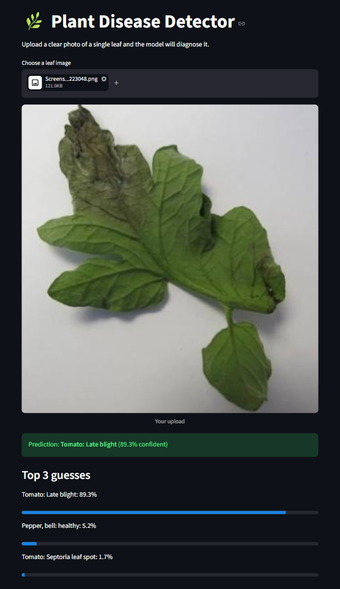

# 🌿 Plant Disease Detector

A deep learning web app that diagnoses plant leaf diseases from a photo.

**🔗 Live demo:** https://plant-disease-detector-3sf9lac3pnclgvxu6wqzbm.streamlit.app


## What it does

Upload a photo of a single leaf and the app predicts the plant and its disease (or "healthy"), with a confidence score and the top 3 guesses. If the model is not confident (below 80%), the app shows a warning instead of a misleading answer.

## Results

| Metric | Value |
|---|---|
| Classes | 38 (14 crops) |
| Training images | ~43,000 |
| Validation images | ~11,000 |
| Validation accuracy | **96.2%** (3 epochs) |

## Tech stack

- **Python**
- **PyTorch + torchvision**: model training and inference
- **MobileNetV2** with transfer learning (pretrained on ImageNet, final layer retrained)
- **PlantVillage dataset** (Kaggle)
- **Streamlit**: web app
- **Google Colab (T4 GPU)**: training
- **Streamlit Community Cloud**: deployment

## How it works

1. Images are resized to 224x224 and augmented (random flips and rotations).
2. MobileNetV2's pretrained layers are frozen and a new classifier layer is trained for 38 classes.
3. The trained weights are saved to `plant_model.pth` and loaded by the Streamlit app.

## Run it locally

```bash
git clone https://github.com/sanjana-l316/plant-disease-detector.git
cd plant-disease-detector
python -m venv venv
venv\Scripts\activate        # Mac/Linux: source venv/bin/activate
pip install streamlit torch torchvision pillow
streamlit run app.py
```

## Limitations

- The model only knows the 14 crops in PlantVillage (apple, blueberry, cherry, corn, grape, orange, peach, pepper, potato, raspberry, soybean, squash, strawberry, tomato). Other plants will get a wrong guess.
- PlantVillage photos are taken in a lab on plain backgrounds, so accuracy drops on real-world photos with messy backgrounds, shadows or blur.
- The model has no "unknown" class, so the app uses a confidence threshold to flag uncertain predictions.

## Future improvements

- Fine-tune deeper layers and train on field photos
- Add an "unknown plant" detection step
- Show treatment suggestions for each disease

## Author

Sanjana L